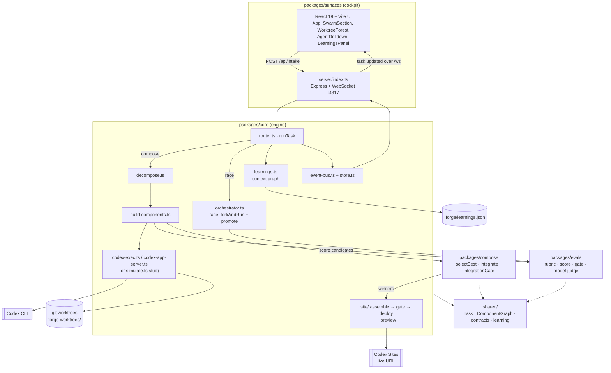

# Forge — Repo Graph

Quick map of the repo for agents. See `README.md` for the full story and `CLAUDE.md` for setup.

## File structure (tracked files)

```
forge/
├── CLAUDE.md                     # setup & operating notes
├── README.md
├── package.json                  # pnpm workspace root (build/lint/test/demo scripts)
├── pnpm-workspace.yaml
├── tsconfig.json / tsconfig.eslint.json / eslint.config.mjs / vitest.config.ts
├── shared/                       # @forge/shared — frozen contracts
│   ├── task.ts                   #   Task, Step, ScoreResult, verdicts
│   ├── component.ts              #   ComponentGraph, ComponentSpec, ComponentCandidate
│   ├── contracts.ts              #   RunAgent / ForkAndRun / Promote signatures
│   └── learning.ts               #   context-graph learning shape
└── packages/
    ├── core/                     # @forge/core — the engine
    │   ├── src/
    │   │   ├── index.ts
    │   │   ├── router.ts         #   runTask → race | compose
    │   │   ├── decompose.ts      #   intent → ComponentGraph
    │   │   ├── build-components.ts  # one Codex agent per candidate, own worktree
    │   │   ├── run-agent.ts
    │   │   ├── codex-exec.ts     #   `codex exec --json` runner
    │   │   ├── codex-app-server.ts  # JSON-RPC runner (alt)
    │   │   ├── orchestrator.ts   #   race mode: forkAndRun + promote
    │   │   ├── learnings.ts      #   context graph (.forge/learnings.json)
    │   │   ├── event-bus.ts      #   task.updated pub/sub
    │   │   ├── store.ts          #   in-memory task store
    │   │   ├── dev.ts / real-run.ts / deploy-run.ts   # CLI entry points
    │   │   └── site/
    │   │       ├── index.ts
    │   │       ├── assemble.ts   #   winners → deployable site
    │   │       ├── gate.ts       #   esbuild compile + contract gate
    │   │       ├── deploy.ts     #   Codex Sites deployer
    │   │       ├── preview.ts    #   playable preview
    │   │       ├── simulate.ts   #   stub build path
    │   │       └── rocket-game.ts
    │   └── test/                 #   codex-app-server, compose, event-bus, orchestrator,
    │                             #   run-agent, site, store
    ├── compose/                  # @forge/compose — select / integrate / gate
    │   ├── src/ fixture.ts gate.ts index.ts integrate.ts replay.ts schemas.ts select.ts
    │   ├── fixtures/artifacts/   #   model-blender, model-online, renderer, shell
    │   └── test/                 #   integration, select
    ├── evals/                    # @forge/evals — rubric, scoring, pass/block/redirect gate
    │   ├── src/ aggregate.ts checks.ts constants.ts contracts.ts fixtures.ts gate.ts
    │   │        index.ts math.ts model-judge.ts replay.ts rubric.ts schemas.ts score.ts
    │   └── test/evals.test.ts
    └── surfaces/                 # @forge/surfaces — cockpit (backend + UI)
        ├── index.html, vite.config.ts, tailwind/postcss configs, vercel.json, .env.example
        ├── src/
        │   ├── main.tsx, App.tsx, RocketGame.tsx, styles.css
        │   ├── server/ index.ts eventBus.ts     # Express + WS (:4317), /api/intake, /ws, /preview/:id
        │   ├── adapters/ intake ciWebhook sites swarm telemetry
        │   ├── components/ AgentDrilldown IntentCard LearningsPanel ShipHealStrip
        │   │               SwarmSection WorktreeForest
        │   ├── stream/ connectTaskUpdates.ts clientSimulation.ts
        │   ├── task/ createTask.ts viewModel.ts
        │   └── shared/task.ts
        └── test/intake.test.ts
```

Gitignored, per-machine: `.env`, `.forge/learnings.json`, `forge-worktrees/`, `dist/`.

## Architecture

Package dependencies (from actual imports): `surfaces → core → {compose, evals} → shared`.



### Compose pipeline (the main path)

```
runTask → decompose → buildComponents (N Codex agents, N worktrees)
        → selectBest → assembleSite → siteGate → deploySite
        (every step emits task.updated → /ws → cockpit)
```
