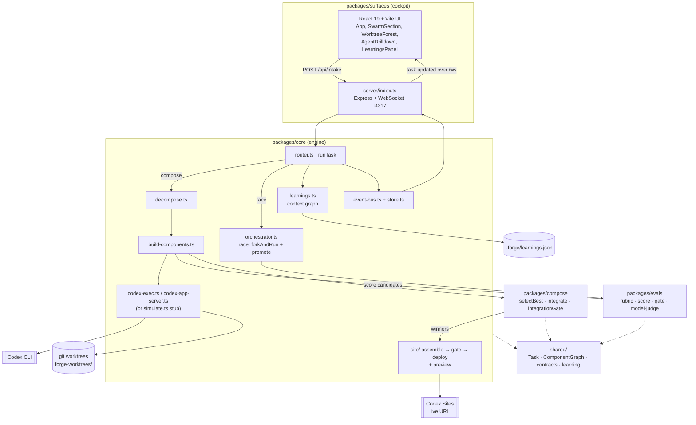

<div align="center">

# 🔥 Forge

### An autonomous software org in a box — type a sentence, watch a swarm of real Codex agents build, judge, assemble, and ship a live product.

[](https://www.typescriptlang.org/)
[](https://pnpm.io/)
[](https://react.dev/)
[](https://openai.com/)
[](https://threejs.org/)
[](#-quality--tests)

**Prompt → Mixture-of-Agents → playable preview → live deployed site.**

</div>

---

## ⚡ The 30-second pitch

You type:

> **"Build me a 3D game using three.js"**

Forge turns that one sentence into a real engineering pipeline:

1. 🧠 **Decompose** the request into independent components with hard interface contracts.
2. 🤖 **Spawn a swarm of real OpenAI Codex agents** — each in its **own isolated git worktree** — that *actually write code to disk* in parallel.
3. 🏆 **Score & select** the best implementation with an evals rubric (a Mixture-of-Agents "best of N").
4. 🧩 **Assemble** the winners into a single deployable site.
5. ✅ **Gate** it with a real compile/contract check.
6. 🚀 **Deploy** it to a **live URL** via Codex Sites.

…and you watch **every step stream live** in a cockpit UI — each agent, each worktree, each score, the gate verdict, a one-click **playable preview**, and the final **deploy link**.

No mocks. No hand-waving. Real agents, real worktrees, real artifacts, real deploys.

---

## 🎬 What it looks like

```
 you ──▶ "Build me a 3D game using three.js"
            │
            ▼
   ┌─────────────────────────────────────────────────────────────┐
   │  DECOMPOSE   game (race ×3)        shell (assign)             │
   └─────────────────────────────────────────────────────────────┘
            │
            ▼   buildComponents()  — real Codex agents, isolated worktrees
   ┌──────────────┐   ┌──────────────┐   ┌──────────────┐   ┌──────────────┐
   │ game:variant1│   │ game:variant2│   │ game:variant3│   │   shell:0    │
   │  worktree A  │   │  worktree B  │   │  worktree C  │   │  worktree D  │
   │  Game.tsx 🟢 │   │  Game.tsx 🟡 │   │  Game.tsx 🟢 │   │  page.tsx 🟢 │
   └──────┬───────┘   └──────┬───────┘   └──────┬───────┘   └──────┬───────┘
          └──────────────────┴───── selectBest() ──────────────────┘
                                   │  🏆 winner
                                   ▼
                         assembleSite() → siteGate() ✅ → deploySite() 🚀
                                   │
                                   ▼
                    ▶ Play the build      🌐 https://…live…
```

The cockpit renders this in real time over a WebSocket: agent rows light up as they work, the integration gate flips green, a **"▶ Play the build"** link appears the instant the gate passes, and the **live deploy URL** lands when Codex Sites finishes.

---

## 🧬 Why it's different

Most "AI builds an app" demos are a single model emitting a single blob of code. Forge is built like an **org**:

- **Mixture-of-Agents, not one shot.** Multiple agents independently build the same component under the *same contract*; the best wins. Diversity → quality.
- **Real isolation.** Every candidate runs in its own **`git worktree`**, so agents never step on each other and the orchestrator can keep, throw away, or compose their output cleanly.
- **A frozen contract.** Everything — intake, agents, evals, compose, deploy — speaks one immutable `Task` shape (`shared/`). Swap any layer without breaking the others.
- **Evals in the loop.** Steps and candidates are scored against a rubric and gated (`pass` / `block` / `redirect`) — the system has *taste*, not just output.
- **It ships itself.** The pipeline doesn't stop at code; it assembles a deployable site and publishes it to a live URL.
- **Glass cockpit.** The whole loop is observable live — you see the agents think, race, get judged, and win.

---

## 🏗️ Architecture

A TypeScript **pnpm monorepo**. Each package owns one concern; `shared/` is the contract that binds them.

```
forge/
├── shared/                     # 🧊 FROZEN contracts — the single source of truth
│   ├── task.ts                 #   Task, Step, ScoreResult, verdicts
│   ├── component.ts            #   ComponentGraph, ComponentSpec, ComponentCandidate
│   └── contracts.ts            #   RunAgent / ForkAndRun / Promote signatures
│
├── packages/core/              # 🧠 the engine
│   ├── decompose.ts            #   prompt → ComponentGraph (race + assign)
│   ├── build-components.ts     #   run a Codex agent per candidate in its own worktree
│   ├── codex-exec.ts           #   real agent runner via `codex exec --json` (writes files)
│   ├── codex-app-server.ts     #   alternate runner over the Codex app-server JSON-RPC
│   ├── orchestrator.ts         #   race mode: forkAndRun + promote
│   ├── router.ts               #   runTask → race | compose, branches to the site path
│   ├── site/
│   │   ├── assemble.ts         #   stage the winning Game.tsx + shell into a deployable site
│   │   ├── gate.ts             #   real esbuild compile + contract gate
│   │   ├── deploy.ts           #   Codex Sites deployer agent (sites plugin/connector)
│   │   └── preview.ts          #   transpile + serve a standalone playable preview
│   ├── event-bus.ts            #   task.updated pub/sub + ws fan-out
│   └── store.ts                #   in-memory task store
│
├── packages/compose/           # 🧩 component composition (static renderer/model/shell path)
│   ├── select.ts               #   selectBest across candidates
│   ├── integrate.ts            #   stitch components under their contracts
│   └── gate.ts                 #   headless integration gate
│
├── packages/evals/             # ⚖️ rubric generation, scoring, gating (pass/block/redirect)
│
├── packages/audio_input/       # 🎙️ audio (wav/mp3) → text via OpenAI transcription
├── packages/doc_ingest/        # 📄 PDF/DOCX/TXT → text + image descriptions via OpenAI
│
└── packages/surfaces/          # 🖥️ the cockpit
    ├── src/server/index.ts     #   Express + WebSocket: /api/intake → core.runTask, /preview/:id
    └── src/                     #   React 19 + Vite UI: live agents, gate, preview, deploy link
```

### Module graph



### The compose pipeline (the heart of Forge)

```ts
runTask(task)                       // mode: "compose"
  → decompose(task)                 // → ComponentGraph: game(race×N) + shell(assign)
  → buildComponents(graph, task)    // → N real Codex agents, N isolated worktrees, live steps
  → selectBest(graph)               // → Mixture-of-Agents winner per component
  → assembleSite(selected, …)       // → deployable site source (winning Game.tsx + page.tsx)
  → siteGate(artifact, task)        // → esbuild compile + contract checks (pass/block)
  → deploySite(artifact, task)      // → Codex Sites (vinext on Cloudflare Workers) → live URL
```

Every arrow emits a `task.updated` event → streamed to the cockpit over `/ws`.

---

## 🎤 Input options

Forge can take an intent from three kinds of input:

- **Text** — the cockpit intent box → `POST /api/intake` (the current path).
- **Audio** — `@forge/audio-input` → `transcribeAudio(path): Promise<string>`. Accepts `.wav` / `.mp3` up to 25 MB; needs `OPENAI_API_KEY`. Override the model with `FORGE_STT_MODEL`.
- **Documents** — `@forge/doc-ingest` → `ingestDocument(path): Promise<{ text, images: { source, description }[] }>`. Handles PDF (including scanned pages, which the model reads), DOCX (text plus descriptions of embedded images) and TXT; needs `OPENAI_API_KEY`.

```ts
import { transcribeAudio } from '@forge/audio-input';

const intent = await transcribeAudio('./brief.mp3');
```

```ts
import { ingestDocument } from '@forge/doc-ingest';

const { text, images } = await ingestDocument('./spec.pdf');
const intent = [text, ...images.map((i) => `[${i.source}] ${i.description}`)].join('\n\n');
```

> **Note:** audio and documents are standalone modules and are **not yet wired into `/api/intake`**. Transcribe or ingest first, then submit the resulting text as an intent.
>
> **In the cockpit:** the intake bar has **Audio** and **Document** buttons. They upload the file to `POST /api/extract/audio` or `POST /api/extract/document` on the backend, and the extracted text (plus any image descriptions) fills the intent box for you to review before hitting **Forge it**. Needs the local backend and `OPENAI_API_KEY` (TXT works without a key).

---

## 🚀 Quickstart

### Prerequisites
- **Node ≥ 20** and **pnpm**
- **OpenAI Codex CLI** authenticated (`codex login`) — Forge drives the real CLI
- For deploys: the Codex **`sites`** plugin enabled (it ships with Codex)

### Install & build
```bash
git clone https://github.com/VanshMomaya7/Forge.git
cd forge
pnpm install
pnpm build      # tsc -b across the workspace
```

### Run the cockpit (two terminals)

**Terminal 1 — the engine (backend + real agents):**
```bash
# PowerShell (Windows)
$env:USE_REAL_CODEX = "1"
$env:CODEX_BIN      = "$PWD\packages\core\node_modules\.bin\codex.CMD"
$env:CODEX_SQLITE_HOME = "$PWD\.codex-runtime\sqlite"
$env:FORGE_CODEX_REASONING = "medium"
$env:FORGE_DEPLOY   = "1"     # also publish to Codex Sites
pnpm --filter @forge/surfaces run server
```

**Terminal 2 — the UI:**
```bash
$env:VITE_FORGE_WS_URL = "ws://127.0.0.1:4317/ws"
pnpm --filter @forge/surfaces run dev
```

Open **http://127.0.0.1:5173/surfaces**, type a prompt, hit send, and watch the swarm build it. When the gate passes you get a **▶ Play the build** link; when the deploy finishes you get a **live site URL**.

> Don't have Codex set up? Leave `USE_REAL_CODEX` unset and the runner falls back to a fast deterministic stub so you can still see the full loop and the cockpit wiring.

---

## 🎛️ Configuration

| Env var | Default | What it does |
|---|---|---|
| `USE_REAL_CODEX` | unset → stub | `1` to drive **real** Codex agents |
| `CODEX_BIN` | `codex` (PATH) | path to the Codex CLI binary |
| `CODEX_SQLITE_HOME` | Codex default | writable dir for Codex session storage (needed in sandboxes) |
| `FORGE_DEPLOY` | off | `1` to run the Codex Sites deploy stage and produce a live URL |
| `FORGE_CODEX_REASONING` | Codex config | `low` / `medium` / `high` reasoning effort for builder agents |
| `FORGE_CODEX_RUNNER` | `exec` | `exec` (writes files) or `app-server` (JSON-RPC stream) |
| `FORGE_DEPLOY_REASONING` | `medium` | reasoning effort for the deploy agent |
| `FORGE_DEPLOY_TIMEOUT_MS` | `1200000` | deploy hard timeout |
| `FORGE_SURFACES_PORT` | `4317` | backend port |
| `FORGE_TASK_MODE` | `compose` | `compose` (Mixture-of-Agents) or `race` (fork & promote) |
| `VITE_FORGE_WS_URL` | `ws://127.0.0.1:4317/ws` | cockpit → live task bus |
| `VITE_FORGE_API_URL` | derived from WS URL | cockpit → REST API |
| `FORGE_STT_MODEL` | `gpt-4o-mini-transcribe` | OpenAI transcription model used by `@forge/audio-input` |
| `FORGE_DOC_MODEL` | `gpt-4.1-mini` | OpenAI model used by `@forge/doc-ingest` (scanned PDF pages, image descriptions) |

---

## 📜 Scripts

| Command | Description |
|---|---|
| `pnpm build` | type-check & build every package (`tsc -b`) |
| `pnpm lint` | eslint across the workspace |
| `pnpm test` | vitest (34 tests) |
| `pnpm demo` | run the race-mode swarm end to end (stub or real) |
| `pnpm compose:replay` | replay the static compose pipeline against fixtures |
| `pnpm evals:replay` | replay the evals rubric/scorer/gate |
| `tsx packages/core/src/real-run.ts` | drive a full real compose run from the CLI |
| `tsx packages/core/src/deploy-run.ts <artifact>` | deploy an assembled site to Codex Sites |

---

## 🧊 The contract (`shared/`)

Everything in Forge is a `Task`. It is intentionally frozen — adapters, agents, evals, and the UI all read and write the same shape.

```ts
interface Task {
  id: string;
  origin: 'human' | 'regression' | 'subtask';
  intent: string;                       // the plain-English request
  mode: 'race' | 'compose';             // orchestration strategy
  context: Record<string, any>;
  graph?: ComponentGraph;               // components + candidates (the swarm)
  selected?: ComponentCandidate[];      // the Mixture-of-Agents winners
  integration?: { artifactPath?; gate?; passed };
  artifact?: { diff?; deployUrl? };     // the live URL lands here
  verdict: 'running' | 'won' | 'lost' | 'blocked' | 'shipped';
  steps: Step[];
  // …
}
```

---

## ✅ Quality & tests

- `pnpm build` ✅ · `pnpm lint` ✅ · `pnpm test` → **34 passing**
- Coverage spans the new three.js site path (decompose → assemble → gate), the intake → WebSocket bridge, and the original evals/compose replays.
- The frozen `shared/` contracts are never reshaped — packages evolve behind them.

---

## 🧠 Design principles

- **Real, not mock.** The default real path runs the actual Codex CLI; agents write actual files into actual worktrees. The cockpit only ever renders real runs.
- **Contract-first.** One immutable `Task` shape. Swap the runner, the judge, or the deploy target without touching the rest.
- **Fallbacks are safety, not theater.** If an agent produces nothing, Forge writes a minimal *real* component so the gate still has something valid — but real agent output is always preferred.
- **Observable end to end.** If it happened, you can watch it happen.

---

## 🗺️ Roadmap

- 🔁 Self-healing loop: telemetry breach → auto-spawn a regression `Task`.
- 🧩 Richer decomposition (engine / mechanics / HUD as separately raced components).
- 🌐 Pluggable deploy targets (Codex Sites today; Vercel/Netlify wrappers next).
- 📈 Eval dashboards and per-agent leaderboards in the cockpit.

---

<div align="center">

**Forge** — type the idea, watch the swarm, ship the product.

</div>
